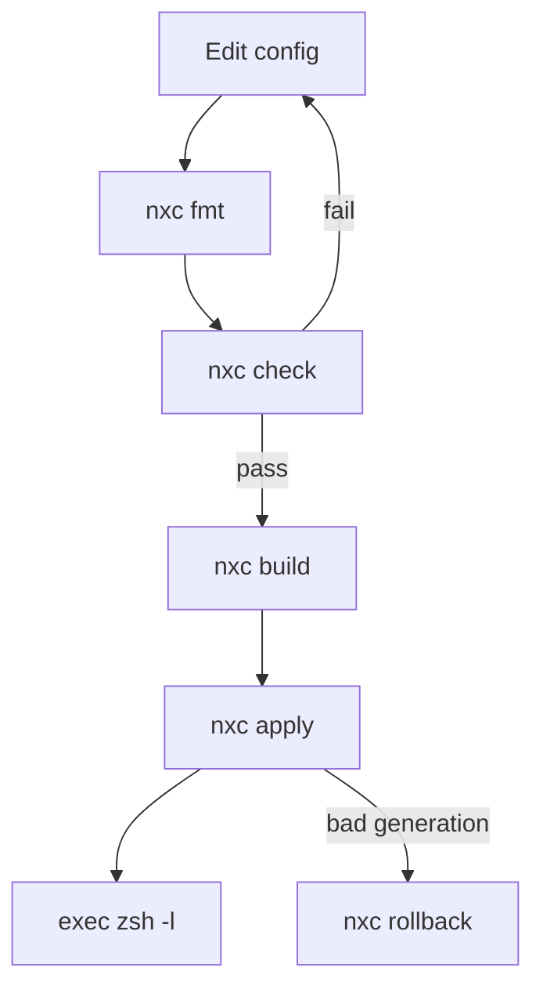

# nix-config

Declarative configuration for macOS (`aarch64-darwin`) and Linux
(`x86_64-linux`), both for user `yumx`. The Mac uses nix-darwin and Home Manager;
Linux uses standalone Home Manager.

## Table of Contents

- [Overview](#overview)
- [Layout](#layout)
  - [Detailed Structure](docs/STRUCTURE.md)
- [Linux Host](#linux-host)
- [Quick Start](#quick-start)
- [Checks](#checks)
- [Everyday Commands](#everyday-commands)
- [Daily Workflow](#daily-workflow)
- [Agent Skills](#agent-skills)
- [Updating](#updating)
  - [Updating Packages](#updating-packages)
  - [Removing a Homebrew Cask](#removing-a-homebrew-cask)
- [Secrets (sops-nix)](#secrets-sops-nix)
  - [Generating the Tokens](#generating-the-tokens)
  - [MCP Configuration](#mcp-configuration)

## Overview

- Nix-darwin manages the macOS system; Home Manager manages user packages and
  dotfiles.
- On Linux, the distribution manages the system and standalone Home Manager
  manages the user environment. Docker, Tailscale, and T3 Code stay under their
  own installers.
- The flake uses the existing Determinate Nix installation on the Mac
  (`nix.enable = false`). Linux uses the Determinate Nix installer as well.
- Nix with `nix-command` and `flakes` is required; `direnv` is optional.
- `nxc` is the repository CLI. Home Manager installs it on both hosts, so it is
  available from any directory after the first activation. It selects the
  matching host configuration automatically.

## Layout

```text
nix-config/
├── flake.nix            # flake inputs and outputs
├── flake.lock           # locked input revisions
├── flake/               # activation, dev shell, Git hooks, host wiring
├── hosts/
│   ├── darwin/          # macOS system entry point
│   └── linux/           # Linux standalone Home Manager entry point
├── modules/
│   ├── darwin/          # macOS system configuration and MCP rendering
│   ├── shared/          # MCP definitions shared by both hosts
│   └── home/
│       ├── agents/      # agents, skills, RTK, and Linux MCP rendering
│       ├── editor/      # Neovim and language tooling
│       ├── nix/         # nxc installation
│       ├── packages/    # common, macOS, and Linux user packages
│       ├── security/    # sops and age setup
│       ├── shell/       # zsh, starship, direnv, and CLI tools
│       ├── terminal/    # Ghostty configuration (macOS)
│       └── vcs/         # Git and credentials
├── pkgs/                # custom packages (nxc, OpenCode, RTK, ...)
├── secrets/             # sops-encrypted secrets
├── docs/                # detailed project documentation
├── .agents/             # repository maintenance skills
├── AGENTS.md            # agent instructions
└── README.md            # project overview and commands
```

See [docs/STRUCTURE.md](docs/STRUCTURE.md) for the full tree and module map.

## Linux Host

The `linux` host runs standalone Home Manager on GNU/Linux. It provides the
same agent tooling, skills, instructions, and MCP servers as the Mac, plus
Docker CLI plugins and a T3 Code service path.
Provisioning, Tailscale, Docker, T3 Connect, and resource tuning are documented
in [docs/LINUX.md](docs/LINUX.md).

First activation on Linux:

```console
nix run .#home-manager -- switch --flake .#linux
exec zsh -l
nxc path
```

After that, use the same `nxc` workflow as on the Mac. `nxc apply` runs
`home-manager switch` on Linux and `darwin-rebuild switch` on the Mac.

## Quick Start

macOS:

```console
nix develop
nix run .#activate
exec zsh -l
nxc path
nxc help
```

- `nix run .#activate` is only needed before `nxc` is installed. After that,
  use `nxc apply`.
- `nix develop` installs Git hooks: formatting and lint checks run before
  commits; the full flake check runs before pushes.

## Checks

Run the full suite from the repository root:

```console
nix fmt -- --ci
nix develop -c bash -c 'statix check . && deadnix .'
nix flake check
nix build .#darwinConfigurations.darwin.system
```

On Linux, the last command is:

```console
nix build .#homeConfigurations.linux.activationPackage
```

After `nxc` is installed, `nxc check` runs the checks for the current host from
any directory. The Mac checks do not build the Linux activation package; run
`nxc check` on Linux to validate that path.

## Everyday Commands

`nxc` manages this repository and does not replace `nh` or any existing shell
alias.

| Command | Description |
| --- | --- |
| `nxc apply` | Activate the configuration for the current host. |
| `nxc build` | Build without activating; writes `result`. |
| `nxc check` | Run formatting, lint, flake checks, and the host build. |
| `nxc fmt` | Format the repository. |
| `nxc update` | Update all flake inputs. |
| `nxc search ripgrep` | Search nixpkgs packages. |
| `nxc options fonts` | Search NixOS, Home Manager, and nix-darwin options. |
| `nxc try ripgrep` | Open a temporary shell with packages from pinned nixpkgs. |
| `nxc rollback` | Roll back the previous generation. |
| `nxc edit packages` | Edit `modules/home/packages/default.nix`. |
| `nxc edit linux` | Edit `hosts/linux/default.nix`. |
| `nxc edit mcp` | Edit `modules/shared/mcp-servers.nix`. |
| `nxc path` | Print the repository path. |
| `nxc help` | Show all commands. |

Details:

- `nxc apply` uses `nix run .#activate` on the Mac and `nh home switch` on
  Linux.
- `nxc build` uses `nh` internally and writes `result`; `nh` is not installed
  separately.
- `nxc check` runs the checks above. `nxc fmt --ci` checks formatting, and
  `nxc update nixpkgs` updates one input; omit the name to update all inputs.
- `nxc try ripgrep --command rg --version` runs one command instead of opening
  a shell.
- `nxc edit` accepts `flake`, `hosts`, `packages`, `packages-common`,
  `packages-darwin`, `packages-linux`, `shell`, `nix`, `mcp`, `darwin`, `linux`,
  or `readme`; other values are paths relative to the repository. With no
  target, it opens the repository root. The editor comes from `VISUAL`, then
  `EDITOR`, then `nvim`.
- `nxc rollback` uses `sudo darwin-rebuild` on the Mac and `home-manager
  rollback` on Linux. Set `NXC_REPO` to override the repository path.
- Add permanent packages with `nxc edit packages-common`, `packages-darwin`, or
  `packages-linux`; use `nxc try` for temporary tools.

## Daily Workflow

After the first activation, the normal loop is:



The same loop applies on Linux; `nxc apply` switches the Home Manager
generation there instead of the nix-darwin system.

## Agent Skills

- Skills are selected in [skills.nix](modules/home/agents/skills.nix) and
  installed into `~/.codex/skills`, `~/.config/opencode/skills`, and
  `~/.gemini/config/skills` during activation.
- Global instructions are rendered for OpenCode (`~/.config/opencode/AGENTS.md`),
  Codex (`~/.codex/AGENTS.md`), and Antigravity
  (`~/.gemini/config/AGENTS.md`).
- Personal skills are maintained in
  [agent-skills](https://github.com/samuelyuma/agent-skills): `agent-instructions`,
  `documentation`, `plan`, `research`, and `writing`. The `personal-skills` flake
  input pins their published revision in `flake.lock`.
- Other skill sources and selections are listed in `skills.nix`.
- Repository maintenance skills live in `.agents/skills/`.
- After publishing changes to personal skills, run `nix flake update personal-skills`,
  then `nxc check` and `nxc apply` to install the updated revision.

## Updating

### Updating Packages

- Nix-managed tools are declared in `modules/home/packages`.
- Update them by bumping the `nixpkgs` lock entry, never with the tool's own
  updater. For example, `bun upgrade` cannot work because the Nix store is
  read-only.
- Replace `<package>` with the tool to verify:

  ```console
  nxc update nixpkgs
  nxc apply
  exec zsh -l
  <package> --version
  ```

- If `nxc` is not installed yet, use `nix flake update nixpkgs` and
  `nix run .#activate` instead.
- The agent-browser CLI, MCP servers, and shell plugins come from the locked
  nixpkgs input. The agent-browser skill comes from its pinned upstream
  repository.
- The OpenCode CLI is pinned in `pkgs/opencode/default.nix`. Update its version
  and archive hash together, then activate. Its self-updater is disabled so Nix
  remains the version owner.

### Removing a Homebrew Cask

1. Delete the entry from the `casks` list in `modules/darwin/default.nix`.
2. Activate:

   ```console
   nxc apply
   ```

   With `onActivation.cleanup = "uninstall"`, brew removes any tracked cask
   missing from the list.

3. Delete leftovers that brew does not track, such as an app installed by hand:

   ```console
   sudo rm -rf "/Applications/<AppName>.app"
   ```

## Secrets (sops-nix)

- GitHub tokens are injected from `secrets/secrets.yaml`, which stays encrypted
  in git.
- MCP tokens are configured in `modules/darwin/mcp.nix`; git push/pull tokens
  are configured in `modules/home/vcs`.
- Never open, decrypt, or edit `secrets/secrets.yaml` directly. Use `sops`.

First-time setup:

1. Run `age-keygen -o ~/.config/sops/age/keys.txt`.
2. Add the printed `age1...` public key to `.sops.yaml`.
3. Run `sops secrets/secrets.yaml`.

### Generating the Tokens

- Create two separate fine-grained PATs at **github.com → Settings →
  Developer settings → Personal access tokens → Fine-grained tokens →
  Generate new token**.
- Never reuse one token for both; they have different scopes and endpoints.

| Token | Access | Permissions |
| --- | --- | --- |
| `mcp_token` | MCP, read-only API use | Contents: Read, Issues: Read, Metadata: Read |
| `personal_access_token` | Git push/pull | Contents: Read and write, Metadata: Read |

- Limit repository access to the repositories you work in.
- Both tokens expire; 90 days is recommended. Regenerate them when pushes or
  MCP calls start failing with auth errors.
- If a selected repository is in an org with SAML enforcement, click
  **Configure SSO → Authorize** on the token, or org access fails silently.
- Replace the placeholders in `secrets/secrets.yaml`:

  ```yaml
  github:
    mcp_token: github_pat_11...
    personal_access_token: github_pat_11...
  ```

- Apply with `nxc apply` (or `nix run .#activate` before `nxc` is installed).
- Set `githubGitCredentials = false` in `flake/hosts.nix` until
  `github/personal_access_token` is configured. Git then uses an in-memory
  cache because this git is built without osxkeychain support. Set the flag to
  `true` and activate to use the sops-rendered `~/.git-credentials`.
- To add another secret:
  1. Add a new key with `sops secrets/secrets.yaml`.
  2. Reference it as `config.sops.placeholder."<section>/<key>"`.
  3. Re-run activation.
- Rotate any token that ever appeared in plaintext configuration.

### MCP Configuration

- MCP settings for Codex, OpenCode, and Antigravity are declared together in
  `modules/darwin/mcp.nix`.
- sops-nix renders their configuration files during system activation with
  ownership and permissions restricted to the configured user.
- Codex reads MCP defaults from `/etc/codex/config.toml`; `~/.codex/config.toml`
  remains available for user settings.
- See the [Codex configuration layers](https://learn.chatgpt.com/docs/config-file/config-basic)
  and [sops-nix templates](https://github.com/Mic92/sops-nix#templates).

When migrating from the previous MCP merger:

- Remove the block between `# BEGIN nix-config MCP servers` and
  `# END nix-config MCP servers` from `~/.codex/config.toml` once.
- Remove any separate definitions for the same managed server names (`github`,
  `nixos`, `sequential-thinking`, and `context7`).
- Remove obsolete `playwright` entries.
- User-level entries override system defaults; other Codex settings can remain
  in that file.
